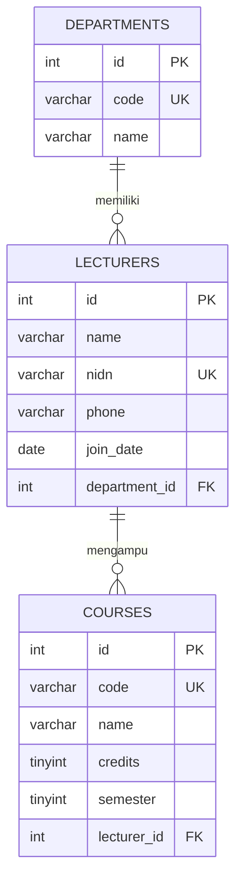
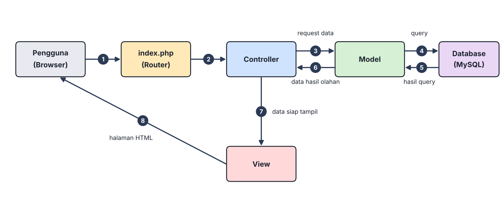
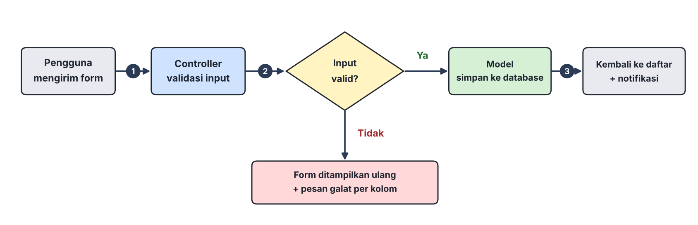

# TP8DPBO2526C2 — Campus Data (PHP MVC)

**Nama:** Ariq Ahmad Fathir
**NIM:** 2506752
**Kelas:** C2
**Mata kuliah:** Desain dan Pemrograman Berbasis Objek, Ilmu Komputer FPMIPA UPI

## Ringkasan

Campus Data adalah aplikasi web sederhana untuk mengelola data akademik: **dosen**, **program studi**, dan **mata kuliah**. Aplikasi ini dikembangkan dari proyek PHP native yang awalnya hanya memiliki satu tabel (`lecturers`) dan seluruh logikanya bercampur dalam satu file. Kode tersebut disusun ulang dengan pola Model-View-Controller, kemudian diperluas dengan dua tabel baru yang saling berelasi beserta fitur CRUD lengkapnya.

Teknologi: PHP 8 (mysqli, prepared statement), MySQL/MariaDB, Bootstrap 5.

## Struktur Repository

```
TP8DPBO2526C2/
├── tp_mvc25/                         # Source code aplikasi (MVC)
│   ├── index.php                     # Front controller / router
│   ├── config.php                    # Konfigurasi koneksi database
│   ├── controllers/
│   │   ├── BaseController.php        # Fungsi bersama semua controller
│   │   ├── LecturerController.php    # Alur halaman dosen
│   │   ├── DepartmentController.php  # Alur halaman program studi
│   │   └── CourseController.php      # Alur halaman mata kuliah
│   ├── models/
│   │   ├── DB.php                    # Koneksi dan eksekusi query
│   │   ├── Lecturer.php              # Query tabel lecturers
│   │   ├── Department.php            # Query tabel departments
│   │   └── Course.php                # Query tabel courses
│   ├── views/
│   │   ├── Template.php              # Kerangka halaman dan helper form
│   │   ├── LecturerView.php          # Tampilan halaman dosen
│   │   ├── DepartmentView.php        # Tampilan halaman program studi
│   │   └── CourseView.php            # Tampilan halaman mata kuliah
│   └── assets/
│       ├── css/bootstrap.min.css
│       └── js/bootstrap.bundle.min.js
├── Dokumentasi/                      # Diagram dan screen record hasil program
│   ├── alur-mvc.png
│   ├── alur-simpan-data.png
│   └── CRUD+validasi                 # Screen record dokumentasi
├── tp_mvc25.sql                      # Skema dan data awal database
└── README.md
```

## Desain Database

Tabel `lecturers` dipertahankan dari proyek awal dan ditambah kolom `department_id`. Dua tabel baru ditambahkan: `departments` dan `courses`.



| Relasi | Jenis | Perilaku saat data induk dihapus |
|---|---|---|
| `departments` → `lecturers` | One-to-many | `department_id` dosen menjadi `NULL`, data dosen tetap ada |
| `lecturers` → `courses` | One-to-many | `lecturer_id` mata kuliah menjadi `NULL`, data mata kuliah tetap ada |

Perubahan pada tabel yang sudah ada: kolom `department_id` pada `lecturers`, serta batasan unik pada `nidn`.

## Desain Arsitektur MVC

| Lapisan | Lokasi | Tanggung jawab |
|---|---|---|
| **Model** | `models/` | Satu-satunya lapisan yang berhubungan dengan database. `DB.php` membungkus koneksi mysqli dan prepared statement; `Lecturer`, `Department`, dan `Course` berisi query untuk entitas masing-masing. |
| **View** | `views/` | Membuat tampilan HTML dari data yang diberikan controller. `Template.php` memuat kerangka halaman (navbar, pesan notifikasi) dan helper form; `LecturerView`, `DepartmentView`, dan `CourseView` membuat tabel serta form tiap entitas. |
| **Controller** | `controllers/` | Menerima request, memvalidasi input, memanggil model, lalu menyerahkan hasilnya ke view. `BaseController` menampung fungsi bersama (redirect, notifikasi, render). |

Seluruh request masuk melalui `index.php` dengan pola URL:

```
index.php?page=<lecturers|departments|courses>&action=<index|create|store|edit|update|delete>
```

| Action | Method | Fungsi |
|---|---|---|
| `index` | GET | Menampilkan daftar data |
| `create` | GET | Menampilkan form tambah |
| `store` | POST | Memproses penambahan data |
| `edit` | GET | Menampilkan form ubah dengan data terisi |
| `update` | POST | Memproses perubahan data |
| `delete` | POST | Menghapus data |

## Alur Program

Pola alur yang sama berlaku untuk ketiga halaman (dosen, program studi, mata kuliah).

### Alur request



| No | Langkah |
|---|---|
| 1 | Pengguna membuka halaman atau mengirim form |
| 2 | `index.php` membaca parameter `page` dan `action`, lalu memanggil controller yang sesuai |
| 3 | Controller meminta data ke model |
| 4 | Model menjalankan query ke database dengan prepared statement |
| 5 | Database mengembalikan hasil query |
| 6 | Model menyerahkan data ke controller |
| 7 | Controller mengirim data ke view |
| 8 | View menyusun HTML yang ditampilkan ke pengguna |

### Alur penyimpanan data



Saat form dikirim, controller memvalidasi input terlebih dahulu. Jika valid, data disimpan lewat model dan pengguna diarahkan kembali ke daftar dengan notifikasi. Jika tidak valid, form ditampilkan ulang dengan isian sebelumnya dan pesan galat pada kolom yang bermasalah. Alur ubah dan hapus mengikuti pola yang sama (`update` dan `delete` pada model). View hanya menyusun tampilan dan tidak pernah mengakses database langsung.

## Fitur

**Dosen (Lecturers)**
- Daftar dosen beserta program studi dan jumlah mata kuliah yang diampu
- Tambah, ubah, dan hapus dosen
- Program studi dipilih melalui dropdown

**Program Studi (Departments)**
- Daftar program studi beserta jumlah dosen
- Tambah, ubah, dan hapus program studi

**Mata Kuliah (Courses)**
- Daftar mata kuliah beserta dosen pengampu
- Tambah, ubah, dan hapus mata kuliah
- Dosen pengampu dipilih melalui dropdown

**Validasi dan keamanan**
- Seluruh query memakai prepared statement
- Output di-escape dengan `htmlspecialchars` untuk mencegah XSS
- Penghapusan memakai method POST dan dialog konfirmasi
- Validasi sisi server: NIDN 10 digit angka, format tanggal, rentang SKS (1–6) dan semester (1–8), kode unik
- Pesan galat ditampilkan pada kolom yang bersangkutan, dan isian pengguna tidak hilang saat validasi gagal

## Cara Menjalankan

1. Salin folder `tp_mvc25` ke `C:\xampp\htdocs\`.
2. Jalankan **Apache** dan **MySQL** melalui XAMPP.
3. Buka `http://localhost/phpmyadmin`, lalu impor file `tp_mvc25.sql`. Database `tp_mvc25` akan dibuat otomatis beserta data contoh.
4. Sesuaikan `tp_mvc25/config.php` jika kredensial MySQL berbeda dari bawaan XAMPP (`root` tanpa password).
5. Buka `http://localhost/tp_mvc25/` di browser.

### Dokumentasi


https://github.com/user-attachments/assets/8b696b00-608b-42ad-8bfd-0fb4c9e138e6


Rekaman memperlihatkan seluruh operasi CRUD pada tiga halaman, perilaku relasi antar tabel, dan validasi form.

| Waktu | Bagian | Yang ditunjukkan |
|---|---|---|
| 00:00 – 00:11 | Program studi | Menambah program studi `TI` (Teknik Informatika) dan `MM` (Multimedia), mengubah nama `TI` menjadi Teknologi Informasi, lalu menghapus `MM` melalui dialog konfirmasi. Tabel menampilkan jumlah dosen tiap program studi. |
| 00:12 – 00:23 | Dosen | Daftar dosen dengan kolom program studi dan jumlah mata kuliah. Menambah dosen baru tanpa memilih program studi (kolom tampil `-`), mengubah data dosen Hendra Wijaya, lalu menghapus dosen uji. |
| 00:24 – 00:33 | Mata kuliah | Daftar mata kuliah beserta dosen pengampu. Menambah `TI101` dan `TI102` dengan memilih dosen lewat dropdown, mengubah `TI102` (SKS, semester, dan dosen pengampu), lalu menghapus `TI102`. |
| 00:34 – 00:40 | Efek relasi | Menghapus program studi `TI`: dosen terkait tetap ada tanpa program studi. Menghapus dosen Hendra: notifikasi menyebut mata kuliah yang diampu kini tanpa dosen pengampu. Menghapus `TI101` untuk membersihkan data uji. |
| 00:41 – 00:51 | Validasi form | Pesan galat muncul di bawah kolom yang salah dan isian lain tidak hilang. Kode mata kuliah `A1` (harus 3–10 huruf/angka), SKS `9` (harus 1–6), kode `IK201` (sudah dipakai), kode program studi `IK` (sudah dipakai), dan NIDN `123` (harus 10 digit angka). |orm.png)
